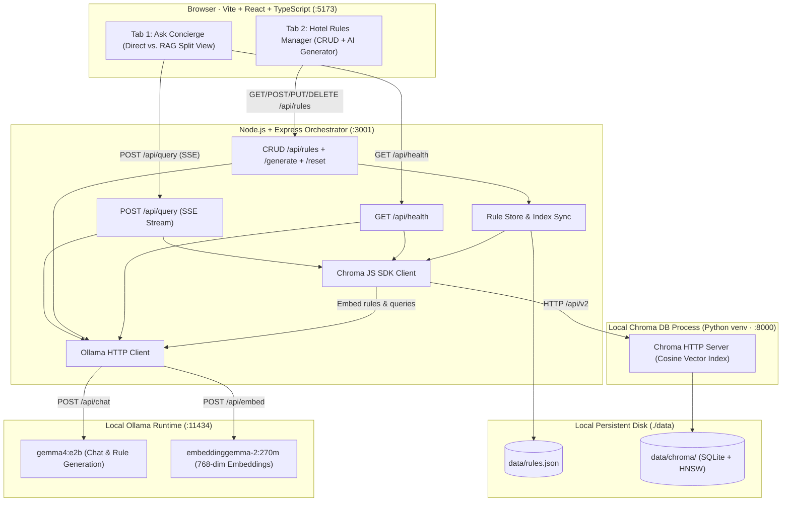
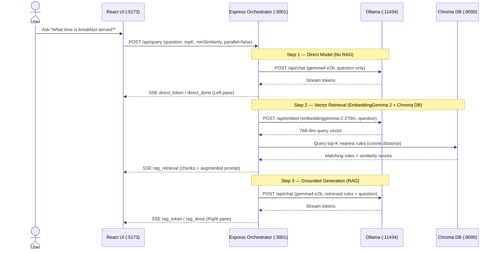

# Grand Aurora Hotel · Local RAG Demonstrator

A fully local **Retrieval-Augmented Generation (RAG)** demonstrator designed to run comfortably within a **4 GB VRAM** GPU budget. It compares a raw open-weights model (**Gemma 4**) side-by-side against the exact same model enriched with custom hotel policy documents embedded via **EmbeddingGemma 2** and retrieved from a local **Chroma DB** vector store.

---

## Key Features

- **Side-by-Side Comparison (Direct vs. RAG):** Submit a guest question once and watch the **Direct Model (No RAG)** answer on the left while the **RAG-Enabled Model** retrieves relevant hotel policies and streams a grounded reply on the right.
- **Full RAG Transparency:** Displays every retrieved hotel rule with its cosine similarity score, retrieval latency, token throughput (`TTFT`, `tok/s`), and an expandable **Inspect Augmented Prompt** drawer showing the exact system and context-injected prompt sent to Gemma 4.
- **4 GB VRAM-Friendly Defaults:** Uses `gemma4:e2b` with thinking disabled (`OLLAMA_THINK=false`), a bounded context window (`OLLAMA_NUM_CTX=4096`), and **sequential inference by default** (Direct first, then RAG) to avoid doubling KV-cache VRAM—with an optional UI toggle for parallel execution on larger GPUs.
- **Live Hotel Rules Knowledge Base:** Ships with 18 realistic *Grand Aurora Hotel* rules across 7 categories (e.g. *"Breakfast is served daily between 6:30 AM and 10:30 AM in the Wintergarden Lounge on the 2nd floor"*). Browse, search, filter, add, edit, delete, reset to defaults, or click **Generate Rule with Gemma**—every change immediately re-embeds into Chroma DB.
- **100% Local, Zero Docker Required:** Runs Ollama on the host, Chroma DB in a self-contained local Python virtual environment (`chroma-env/`), and the Node.js + React web app locally.

---

## Component Architecture



### End-to-End Request Flow (Sequential 4 GB VRAM Mode)



---

## Prerequisites

1. **Ollama** installed and running locally at `http://127.0.0.1:11434`:
   - Install from [ollama.com](https://ollama.com) if not already installed.
   - Pull the LLM and embedding models:
     ```bash
     ollama pull gemma4:e2b
     ollama pull embeddinggemma-2:270m
     ```
   - Verify both models are available:
     ```bash
     ollama list
     ```
2. **Node.js 22+** and **npm** (e.g., via `nvm`).
3. **Python 3.12+** or **[`uv`](https://docs.astral.sh/uv/)** (used by `scripts/setup-chroma.sh` to create the isolated `chroma-env/` virtual environment without Docker).

---

## Installation & Setup

```bash
# 1. Navigate to the project directory
cd /home/avedave/projects/local-rag

# 2. Create your environment file (if not already present)
cp .env.example .env

# 3. Install Node workspace dependencies and set up the local Chroma DB Python venv
npm run setup
```

What `npm run setup` does:
- Installs root, `server/`, and `client/` npm packages.
- Runs `scripts/setup-chroma.sh`, which creates `./chroma-env` (using `uv` with Python 3.12 if available, otherwise `python3 -m venv`) and installs `chromadb`.

---

## Running the Application

### Development Mode (Recommended)

Start all three local processes—Chroma DB (`:8000`), Express API (`:3001`), and Vite dev server (`:5173`)—in a single terminal:

```bash
npm run dev
```

Open **http://localhost:5173** in your browser.

On first startup, the Express server automatically:
1. Seeds `data/rules.json` with 18 default *Grand Aurora Hotel* rules.
2. Embeds all 18 rules with `embeddinggemma-2:270m` and indexes them into Chroma DB (`data/chroma/`).

### Production Build & Start

Build both the TypeScript server and the static React bundle, then serve everything from Express on port `3001`:

```bash
npm run build
npm start
```

Open **http://localhost:3001** in your browser.

### Running Services Individually (Optional)

If you prefer separate terminals for debugging:

```bash
# Terminal 1 — Local Chroma DB
npm run chroma

# Terminal 2 — Express RAG Orchestrator
npm run dev:server

# Terminal 3 — Vite React UI
npm run dev:client
```

---

## Configuration (`.env`)

All runtime parameters can be customized in `.env` (see `.env.example`):

| Variable | Default | Description |
| --- | --- | --- |
| `OLLAMA_BASE_URL` | `http://127.0.0.1:11434` | Local Ollama HTTP endpoint |
| `LLM_MODEL` | `gemma4:e2b` | Chat completion model tag in Ollama |
| `EMBED_MODEL` | `embeddinggemma-2:270m` | Embedding model tag in Ollama |
| `OLLAMA_NUM_CTX` | `4096` | Context length (limits KV-cache VRAM for 4 GB GPUs) |
| `OLLAMA_THINK` | `false` | Enables/disables Gemma 4 internal reasoning tokens |
| `OLLAMA_TEMPERATURE` | `0.2` | Sampling temperature (low value improves factual grounding) |
| `CHROMA_HOST` | `127.0.0.1` | Host for the local Chroma DB server |
| `CHROMA_PORT` | `8000` | Port for the local Chroma DB server |
| `CHROMA_COLLECTION` | `grand_aurora_hotel_rules` | Chroma collection name |
| `SERVER_PORT` | `3001` | Express API server port |

### Notes on the 4 GB VRAM Target

- **`embeddinggemma-2:270m`** uses ~360–380 MB of VRAM.
- **`gemma4:e2b`** uses 2B effective parameters per token (Q4_K_M quantization), keeping active compute layers small while `OLLAMA_NUM_CTX=4096` and `OLLAMA_THINK=false` keep KV cache memory and latency low.
- **Sequential mode (default)** runs the Direct call first and the RAG call second so Ollama only serves one generation slot at a time. Check **Run in parallel** in the UI if you have extra VRAM and want both panes to stream simultaneously.

---

## Live Demo Walkthrough

1. **Check Health Pills:** Confirm the top-right status bar shows green dots for `LLM: gemma4:e2b`, `Embed: embeddinggemma-2:270m`, and `Chroma: 18 vectors`.
2. **Compare Direct vs. RAG:** On **Ask Concierge**, click the **Breakfast hours** chip (`"What time is breakfast served, and which floor is it on?"`).
   - **Left (Direct Model):** Without hotel rules, Gemma 4 either gives a generic hotel guess or admits it doesn't know.
   - **Right (RAG-Enabled):** Retrieves *Breakfast Hours & Location* from Chroma DB (~85% match) and answers accurately (*6:30 AM to 10:30 AM in the Wintergarden Lounge on the 2nd floor*).
3. **Inspect the Prompt:** Expand **Inspect Augmented Prompt** at the bottom of the right card to show how retrieved rules are injected into the model's context window.
4. **Demonstrate Live Knowledge Updates:**
   - Switch to **Hotel Rules Manager**.
   - Click **Edit** on *Breakfast Hours & Location* and change `6:30 AM and 10:30 AM` to `7:15 AM and 11:00 AM`, then click **Save & Re-embed**.
   - Switch back to **Ask Concierge** and click **Re-run Question** in the green banner—the RAG pane immediately reflects the new hours without retraining the model.
5. **Generate a New Rule with Gemma:** In **Hotel Rules Manager**, click **✦ Generate Rule with Gemma** to have `gemma4:e2b` draft a brand-new hotel policy in JSON and automatically embed it in Chroma DB.
6. **Experiment with Retrieval Controls:** Adjust **Top-K Rules** (`1–6`) and **Min Similarity** (`0%–75%`) to demonstrate how retrieval thresholds impact grounding quality.

---

## API Reference

| Method & Path | Description |
| --- | --- |
| `GET /api/health` | Returns Ollama status, model availability, VRAM usage, Chroma connection, and indexed vector count |
| `GET /api/rules` | Lists all hotel rules, categories, and sample questions |
| `POST /api/rules` | Creates a new rule, embeds it via Ollama, and upserts it into Chroma DB |
| `PUT /api/rules/:id` | Updates a rule and immediately re-embeds it in Chroma DB |
| `DELETE /api/rules/:id` | Deletes a rule from local storage and removes its vector from Chroma DB |
| `POST /api/rules/generate` | Uses `gemma4:e2b` to generate a new hotel rule, saves it, and embeds it into Chroma DB |
| `POST /api/rules/reindex` | Rebuilds the Chroma DB collection from `data/rules.json` |
| `POST /api/rules/reset` | Restores the 18 default hotel rules and rebuilds the Chroma DB index |
| `POST /api/query` | Streams SSE events (`meta`, `direct_start`, `direct_token`, `direct_done`, `rag_start`, `rag_retrieval`, `rag_token`, `rag_done`, `done`) |

---

## Project Structure

```text
local-rag/
├── .env.example                 # Template configuration
├── .env                         # Active local configuration (gitignored)
├── package.json                 # Root npm workspaces & dev/build/start scripts
├── scripts/
│   ├── setup-chroma.sh          # Creates local Python venv and installs chromadb
│   └── start-chroma.sh          # Launches `chroma run` persisted to ./data/chroma
├── data/                        # Generated at runtime (gitignored)
│   ├── rules.json               # Local JSON source of truth for hotel rules
│   └── chroma/                  # Persistent Chroma DB vector store
├── server/                      # Express + TypeScript backend & RAG orchestrator
│   └── src/
│       ├── config.ts            # Environment loader
│       ├── types.ts             # Shared TypeScript interfaces
│       ├── index.ts             # Express entry point & startup auto-indexing
│       ├── data/defaultRules.ts # 18 Grand Aurora Hotel policies & sample questions
│       ├── services/
│       │   ├── ollama.ts        # /api/embed, streaming /api/chat, rule generation, health
│       │   ├── chroma.ts        # Chroma JS client, cosine collection sync & search
│       │   └── ruleStore.ts     # JSON persistence & Chroma synchronization
│       └── routes/
│           ├── health.ts        # GET /api/health
│           ├── rules.ts         # Rule CRUD, AI generation, re-index, reset
│           └── query.ts         # POST /api/query SSE comparison pipeline
└── client/                      # Vite + React + TypeScript web UI
    ├── index.html
    └── src/
        ├── App.tsx              # Tab state, SSE streaming state, health & CRUD wiring
        ├── api.ts               # Fetch helpers & SSE parser
        ├── styles/global.css    # Light/dark tokens, native dialog/details/form styling
        └── components/
            ├── Header.tsx       # Brand bar, live service health pills, top-level tabs
            ├── AskConcierge.tsx # Question composer, sample chips, Top-K/similarity controls
            ├── ResponseCard.tsx # Direct & RAG cards, similarity bars, prompt inspector
            ├── RulesManager.tsx # Searchable, filterable hotel rule cards & toolbar
            └── RuleModal.tsx    # Native <dialog> add/edit & confirmation modals
```

---

## Troubleshooting

- **Ollama shows disconnected or model missing:** Ensure Ollama is running (`ollama serve` or system service) and pull both models (`ollama pull gemma4:e2b` and `ollama pull embeddinggemma-2:270m`).
- **Chroma DB fails to start on Python 3.14:** Install [`uv`](https://docs.astral.sh/uv/) and re-run `rm -rf chroma-env && npm run setup:chroma` so `setup-chroma.sh` automatically provisions Python 3.12 with prebuilt `chromadb` wheels.
- **Chroma vector count is `0`:** Click **Re-index Chroma** in the **Hotel Rules Manager** tab (or `curl -X POST http://127.0.0.1:3001/api/rules/reindex`).
- **Port conflict on `8000`, `3001`, or `5173`:** Update `CHROMA_PORT` or `SERVER_PORT` in `.env` (and update the `/api` proxy target in `client/vite.config.ts` if changing `SERVER_PORT`).
